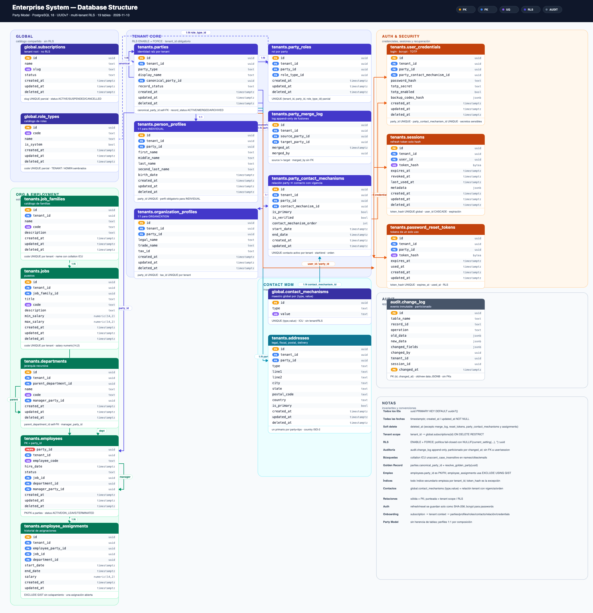

# Estructura de base de datos

Diagrama de las **19 tablas** definidas hasta el rediseño de Contact MDM.



- [SVG vectorial](database-er.svg)
- [Fuente Mermaid](database-er.mmd)
- [Generador del SVG](generate_diagram.py)

## Leyenda

| Símbolo | Significado |
|---|---|
| `PK` | Primary key |
| `FK` | Foreign key |
| `UQ` | Unique / unique parcial |
| `PK/FK` | La PK es a la vez FK (`employees.party_id`) |
| Línea sólida | Relación FK |
| Línea punteada | Alcance de tenant / RLS |
| `RLS` | `ENABLE` + `FORCE ROW LEVEL SECURITY` |
| `AUDIT` | Trigger `audit.fn_log_change()` |

## Grupos

### `global` — catálogo compartido, sin RLS

- `global.subscriptions`: tenant raíz (`id`, `name`, `slug`, `status`).
- `global.role_types`: catálogo de roles; incluye `TENANT` y `ADMIN`.
- `global.contact_mechanisms`: maestro global de contactos (`id`, `type`, `value`), único por `(type, value)`.

### `tenants` — datos con aislamiento por tenant

Todas llevan `tenant_id uuid NOT NULL` con FK a `global.subscriptions(id)` y RLS forzado.

| Tabla | Propósito |
|---|---|
| `parties` | Identidad raíz; `INDIVIDUAL` u `ORGANIZATION`; Golden Record. |
| `person_profiles` | Perfil 1:1 para parties `INDIVIDUAL`. |
| `organization_profiles` | Perfil 1:1 para parties `ORGANIZATION`. |
| `party_roles` | Rol de una party (`TENANT`, `ADMIN`, etc.). |
| `party_merge_log` | Historial append-only de fusiones. |
| `sessions` | Refresh tokens; solo `token_hash`. |
| `user_credentials` | Hash de contraseña, TOTP y backup codes; FK única a `party_contact_mechanism_id`. |
| `password_reset_tokens` | Tokens de reset de un solo uso. |
| `job_families` | Catálogo de familias de puestos. |
| `jobs` | Puestos y rango salarial. |
| `departments` | Jerarquía organizacional recursiva. |
| `employees` | Empleo; PK = `party_id`. |
| `employee_assignments` | Historial de asignaciones con vigencia. |
| `party_contact_mechanisms` | Relación party ↔ contacto global con vigencia, orden, `is_primary` e `is_verified`. |
| `addresses` | Direcciones legal/fiscal/postal/entrega. |

### `audit` — trazabilidad

- `audit.change_log`: append-only, particionada mensualmente por `changed_at`.
- **Sin FKs** a usuarios o sesiones: conserva el historial aunque se eliminen.
- `changed_by`, `tenant_id` y `session_id` son valores, no referencias.
- Los triggers de credenciales y reset redactan secretos/hashes.

## Relaciones principales

- `subscriptions 1:N` todas las tablas `tenants.*` mediante `tenant_id`.
- `role_types 1:N party_roles` mediante `role_type_id`.
- `parties 1:1 person_profiles` / `organization_profiles` mediante `party_id` único.
- `parties 1:N party_roles`, `sessions`, `password_reset_tokens`, `party_contact_mechanisms`, `addresses`.
- `global.contact_mechanisms 1:N party_contact_mechanisms` mediante `contact_mechanism_id`.
- `party_contact_mechanisms 1:1 user_credentials` mediante `party_contact_mechanism_id` único.
- `parties 1:1 user_credentials` y `parties 1:1 employees`.
- `global.contact_mechanisms` es maestro compartido; la vigencia (`start_date`/`end_date`) y el orden viven en `party_contact_mechanisms`.
- `parties` tiene self-FK `canonical_party_id` para Golden Record.
- `party_merge_log` referencia `source_party_id` y `target_party_id`.
- `job_families 1:N jobs`.
- `jobs`, `departments` y `employees` alimentan `employees` y `employee_assignments`.
- `departments` tiene self-FK `parent_department_id` y `manager_party_id` → `employees`.
- `employees` tiene self-FK `manager_party_id`.

## Invariantes y convenciones

- **PK**: `uuid PRIMARY KEY DEFAULT uuidv7()` salvo `employees.party_id` (PK/FK).
- **Fechas**: `timestamptz`; `created_at`/`updated_at` `NOT NULL`.
- **Soft delete**: `deleted_at timestamptz`; excepciones: `party_merge_log`, `password_reset_tokens`, `party_contact_mechanisms` y `employee_assignments`.
- **RLS**: `ENABLE` + `FORCE`; política fail-closed con `NULLIF(current_setting('app.current_tenant_id', true), '')::uuid`.
- **Índices**: los secundarios empiezan por `tenant_id`; `token_hash` es la excepción deliberada para resolver tokens antes de conocer el tenant.
- **Perfiles**: no hay herencia de tablas; composición 1:1.
- **Empleo**: una sola asignación abierta por empleado y sin solapamiento mediante `EXCLUDE USING GIST`.
- **Contactos/direcciones**: el contacto global es único por `(type, value)`; la relación party-contacto tiene vigencia (`start_date`/`end_date`) y `contact_mechanism_order`. Un contacto global solo puede estar activo una vez por tenant. Las direcciones mantienen un solo primario por party y tipo.
- **Onboarding**: `subscription` → contexto tenant diferido → parties/perfiles/roles/contacto global/relación/credentials en una transacción.
- **Auditoría**: `audit.change_log` no tiene FKs y es inmutable.

## Regenerar el diagrama

```bash
python3 docs/database/generate_diagram.py
```

El generador solo usa la librería estándar de Python y escribe `database-er.svg`. Para PNG se puede rasterizar el SVG con Chrome/Chromium o cualquier conversor SVG.

La fuente Mermaid (`database-er.mmd`) es la representación portable para GitHub/GitLab o editores con soporte Mermaid.
